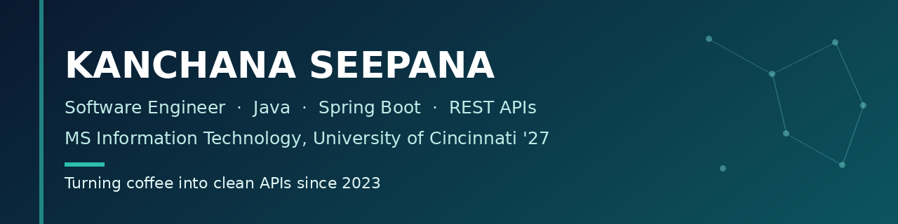

  

  

## 👋 Hey, I'm Kanchana

💻 Software Engineer with ~3 years at **Nagarro**, where I built backend services with Java, Spring Boot, REST APIs, MySQL and microservices for telecom and automotive clients.

🎓 Now doing my **MS in Information Technology at the University of Cincinnati** (graduating May 2027, GPA 4.0), working as a Graduate Assistant (C#, ASP.NET MVC, SQL Server) and previously as a Research Assistant on Ansible and infrastructure as code.

🚀 **Currently looking for:** internships and co-ops in IT and software roles, anywhere in the United States, Spring and Summer 2027.

📍 Cincinnati, OH

## 🛠️ My toolbox

**Proficient**

**Familiar**

## 📊 GitHub stats

  
  

## 📚 Publications

Yes, the repos below have papers behind them. Peer reviewed and everything. 🎉

- 📄 **Sentimental Analysis on Product Reviews Using Support Vector Machine and Naïve Bayes**, *Applied and Computational Engineering*, 2023. [doi.org/10.54254/2755-2721/2/20220586](https://doi.org/10.54254/2755-2721/2/20220586)
- 📄 **Multi chronic disease prediction: A survey**, *Applied and Computational Engineering*, 2023. [doi.org/10.54254/2755-2721/5/20230579](https://doi.org/10.54254/2755-2721/5/20230579)
- 📄 **Multi Chronic Disease Prediction System Using CNN and Random Forest**, *SN Computer Science* (Springer), 2024. [doi.org/10.1007/s42979-023-02521-6](https://doi.org/10.1007/s42979-023-02521-6)

## 🐛 Bug or feature?

It's a feature. It was always a feature. The documentation just hasn't caught up yet.

⚡ Fun facts about me:
- My code has been published in journals, but my best debugging tool is still `System.out.println`
- I built the SIM provisioning, migration and port-in/port-out flows used by real telecom customers
- I read error logs the way other people read horoscopes: daily, and with full belief

## 🤝 Let's connect

  

